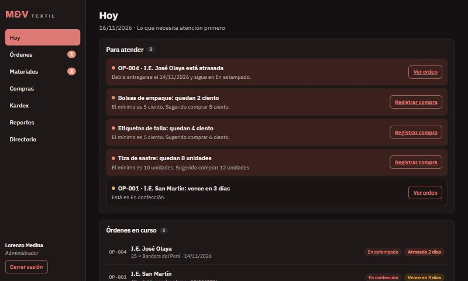
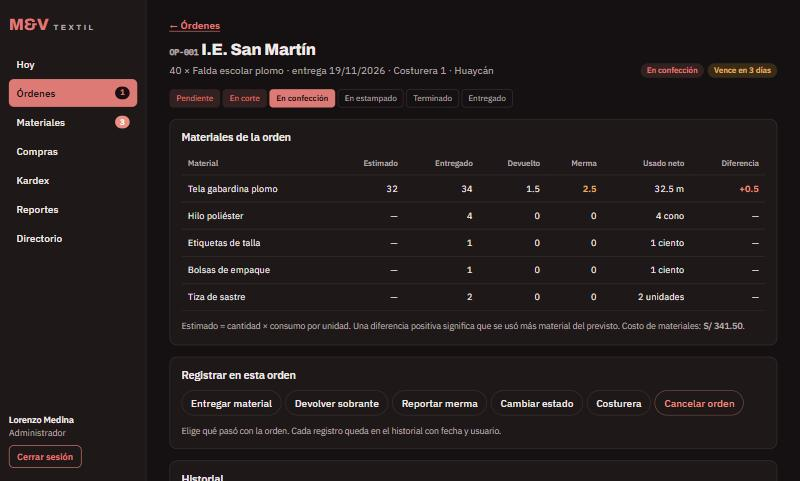
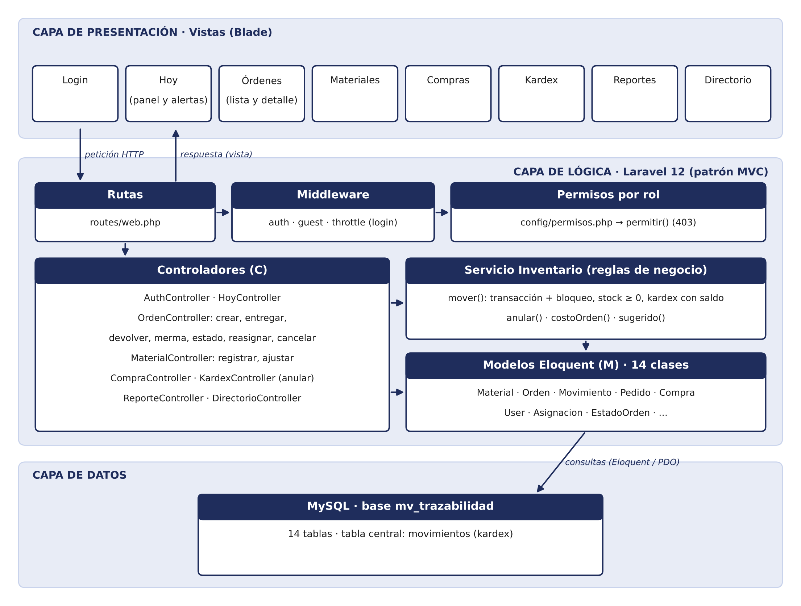
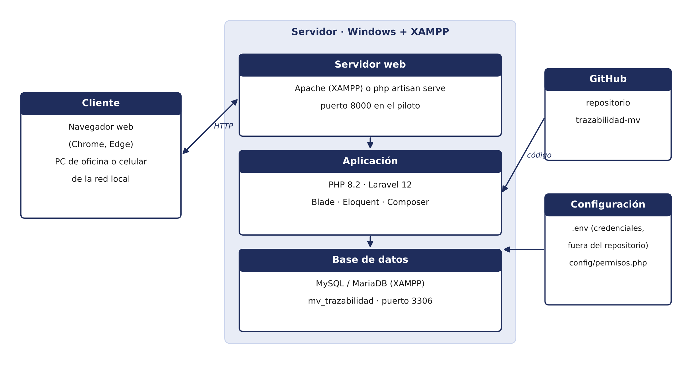
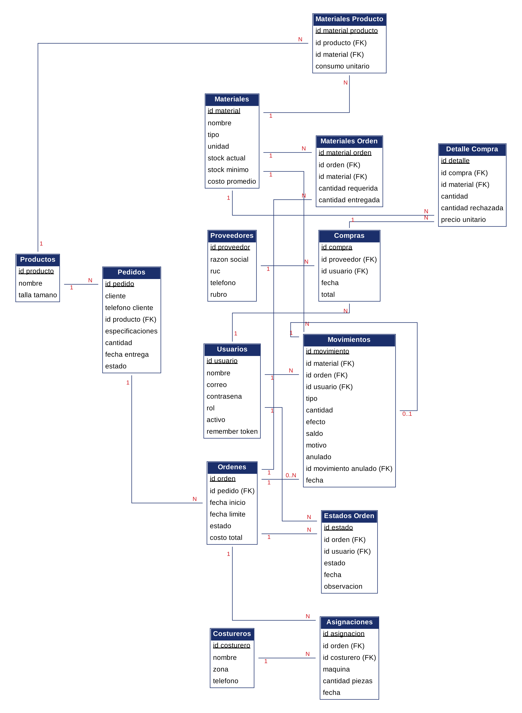
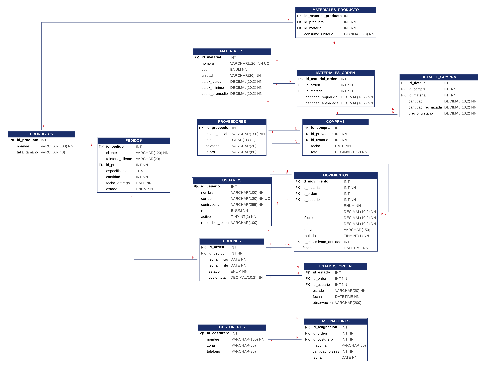
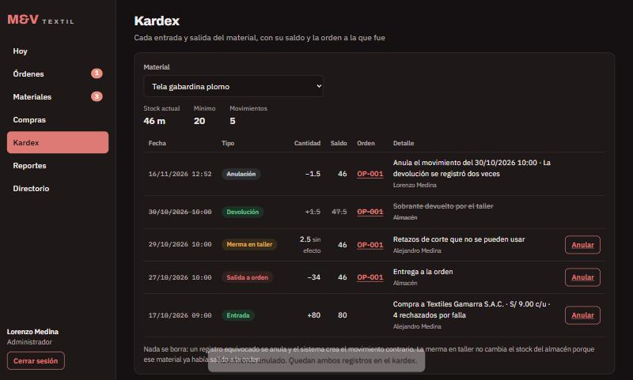

# Sistema de trazabilidad de materiales y órdenes de producción

**M & V Technology Textil S.A.C. · Ate, Lima · 2026**
Prácticas preprofesionales de Ingeniería de Sistemas, UCV, campus Ate. Autor: Isais Luis Alberto Cardenas Jimenez.

Aplicación web que registra cada movimiento de material del taller (compras, entregas a órdenes, devoluciones, merma y ajustes) y el avance de cada orden de producción. Reemplaza las libretas por pedido y la coordinación por WhatsApp. Además, avisa cuando un insumo llega a su stock mínimo, para que la línea de empaque no se detenga en plena campaña.



## Qué hace

| Módulo | Qué permite | Requerimiento |
|---|---|---|
| Acceso y roles | Inicio de sesión con 5 roles y permisos por acción | RF-01 |
| Hoy | Órdenes atrasadas o por vencer y alertas de stock mínimo con compra sugerida | RF-08 |
| Pedidos y órdenes | Crear el pedido y su orden con la receta; entregar, devolver, registrar merma, cambiar etapa, asignar costurera y máquina, cancelar | RF-05 a RF-07, RF-11, RF-12 |
| Materiales | Registro de materiales y ajuste por conteo físico | RF-02, RF-13 |
| Compras | Entradas con unidades rechazadas por falla y costo promedio ponderado | RF-04 |
| Kardex | Historial con saldo por material y anulación con movimiento contrario | RF-09, RF-14 |
| Reportes | Costo de materiales y merma por orden y por costurera | RF-10 |
| Directorio | Proveedores y costureras | RF-03 |

## Reglas de negocio principales

- **RN-01:** el stock nunca queda negativo. Cada movimiento se guarda dentro de una transacción que bloquea el material.
- **RN-02:** nada se borra. Un error se anula y el sistema crea el movimiento contrario.
- **RN-03 / RN-04:** la merma y la devolución no pueden superar el material que tiene la orden (entregado − devuelto − merma).
- **RN-05 / RN-06 / RN-07:** la orden avanza una etapa a la vez, no pasa a confección sin costurera y, una vez cerrada, no recibe material.
- **RN-08:** compra sugerida = 2 × stock mínimo + pendiente de las órdenes − stock actual.
- **RN-09:** lo rechazado en una compra no entra al stock.
- **RN-10:** cada rol solo realiza sus acciones (`config/permisos.php`).



## Arquitectura

Laravel 12 sobre PHP 8.2+, patrón MVC en tres capas y base de datos MySQL. Todas las reglas que modifican el stock están en un solo componente: `app/Services/Inventario.php`.





## Base de datos

14 tablas y 18 llaves foráneas. La tabla central es `movimientos`, que funciona como el kardex.

- Script SQL: [`bd/mv_trazabilidad.sql`](bd/mv_trazabilidad.sql)
- Migración: `database/migrations/2026_11_02_000001_create_trazabilidad_tables.php`

| Modelo lógico | Modelo físico |
|---|---|
|  |  |



## Ejecutar en Windows (XAMPP)

1. Copia el proyecto en `C:\xampp\htdocs\trazabilidad-laravel`.
2. Ejecuta `INSTALAR-TRAZABILIDAD.bat` una sola vez: configura MySQL, crea la base y carga los datos de ejemplo. Borra los datos anteriores.
3. Después usa siempre `INICIAR-SISTEMA.bat` y abre `http://127.0.0.1:8000`.

Usuarios de ejemplo: `lorenzo@`, `alejandro@`, `almacen@`, `ventas@` y `consulta@mvtextil.pe`. En local, la contraseña es `demo123`.

## Publicar en un servidor (Ubuntu 24.04)

Como root, en un droplet limpio:

```bash
curl -fsSL https://raw.githubusercontent.com/USUARIO/REPO/main/deploy/servidor.sh -o s.sh && bash s.sh https://github.com/USUARIO/REPO.git
```

El script instala Nginx, PHP 8.3 y MySQL, crea la base de datos, configura Laravel en modo producción con una contraseña nueva para los usuarios de ejemplo, activa el firewall e intenta activar HTTPS.

## Estructura del código

| Ruta | Contenido |
|---|---|
| `routes/web.php` | Rutas de la aplicación |
| `app/Services/Inventario.php` | Reglas de stock: `mover()`, `anular()`, `enPoder()`, costo y compra sugerida |
| `app/Http/Controllers/` | Órdenes, compras, materiales, kardex, reportes y directorio |
| `app/Models/` | Un modelo Eloquent por tabla |
| `config/permisos.php` | Acciones permitidas por rol |
| `resources/views/` | Pantallas en Blade |
| `database/` | Migraciones y datos de ejemplo |
